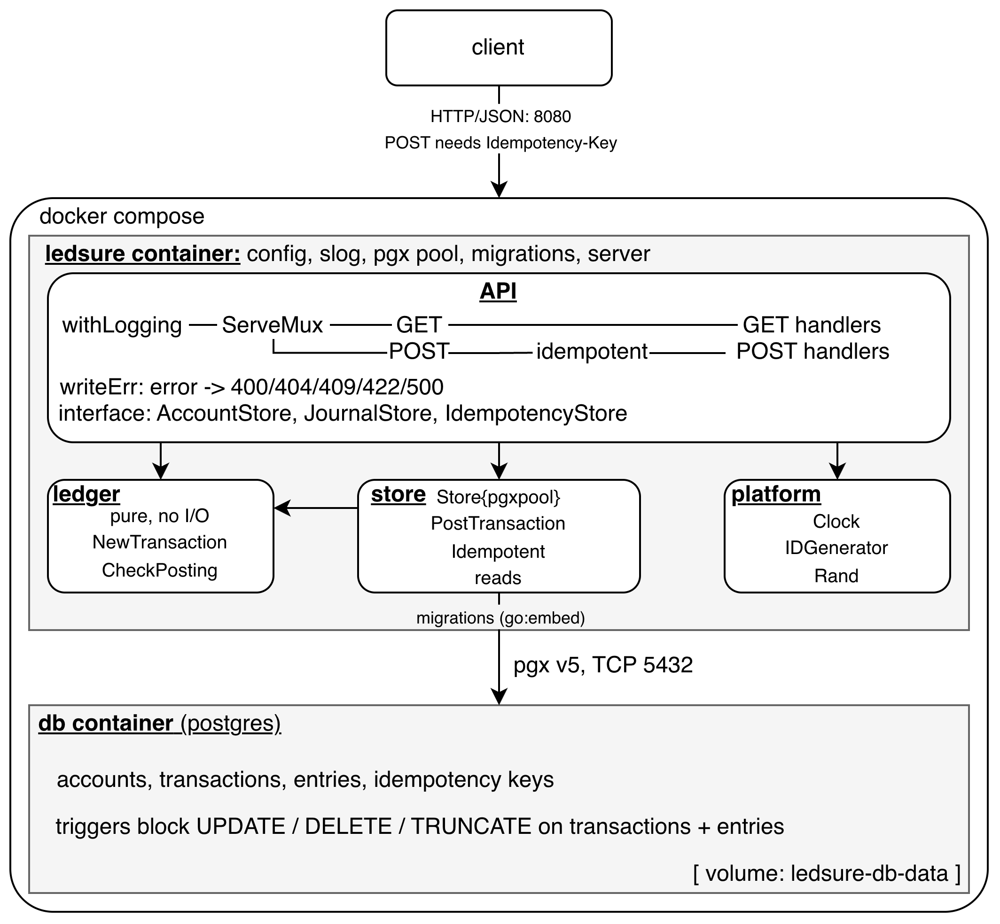

# ledsure

A double-entry, event-sourced ledger and payments service built to prove it stays correct under failure. Money is never created, lost or double-charged, even with retries.


## Quickstart

```sh
docker compose up --build 
# or
make up

curl http://localhost:8080/healthz
# {"status":"ok"}

./scripts/demo.sh # quick feature walkthrough
```

## Project layout

| Path | Purpose |
|---|---|
| `cmd/ledsure/` | `main`: config, logger, DB, router, server lifecycle |
| `internal/ledger/` | Domain types, validation, posting rules |
| `internal/store/` | Postgres |
| `internal/api/` | HTTP handlers, idempotency middleware, error mapping |
| `internal/platform/` | `Clock`, `IDGenerator`, `Rand` |
| `migrations/` | goose SQL migrations |

## Architecture



## API Reference

| Method | Path | Description |
|---|---|---|
| `GET` | `/v1/healthz` | check liveness |
| `POST` | `/v1/accounts` | {name, currency} -> 201 |
| `GET` | `/v1/accounts/{acc_id}` | customer/system |
| `GET` | `/v1/accounts/{acc_id}/balance` | {id, balance, currency, as_of_seq} |
| `GET` | `/v1/accounts/{acc_id}/entries` | returns next_after_seq |
| `GET` | `/v1/system-accounts` | seeded system accounts |
| `POST` | `/v1/transactions` | {description, entries:[{acc_id, amount}]} -> 201 |
| `GET` | `/v1/transactions/{tran_id}` | with entries |

## Errors

| Code | Description |
|---|---|
| `400` | invalid request, missing idempotency key |
| `404` | not found |
| `409` | conflict |
| `422` | insufficient funds, currency mismatch, unbalanced transaction |

## Development

```sh
make up
make test # unit tests
make test-integration # integration tests
make lint
make down
```

See the [Makefile](Makefile) for the rest of the targets and [.env.example](.env.example) for config.

---

Inspired by [TigerBeetle](https://tigerbeetle.com/)